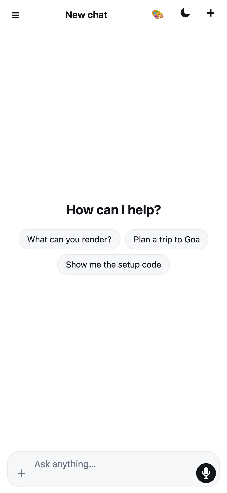
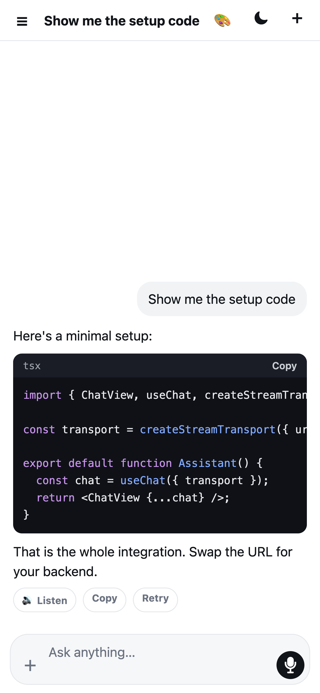
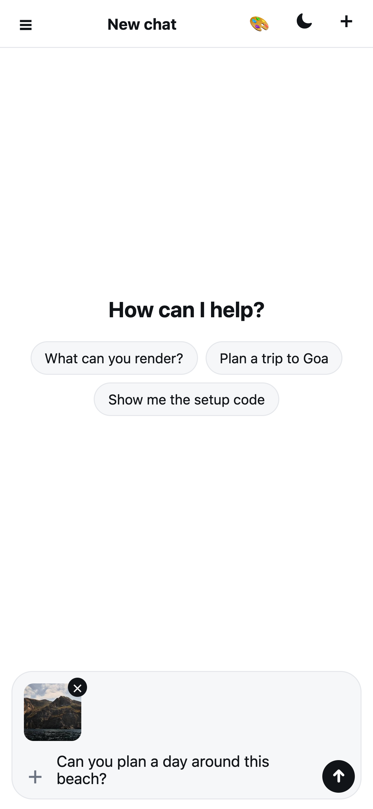
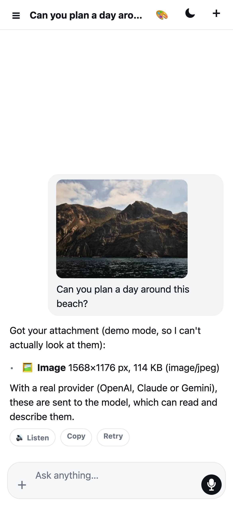
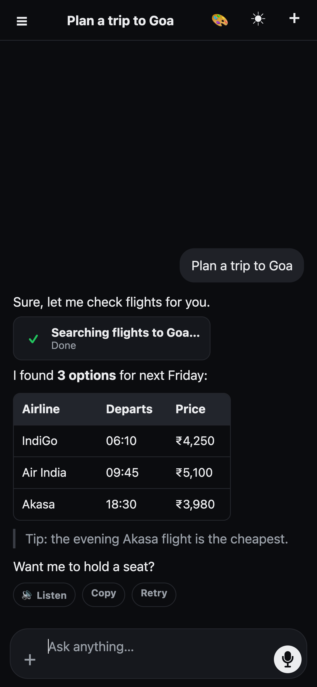
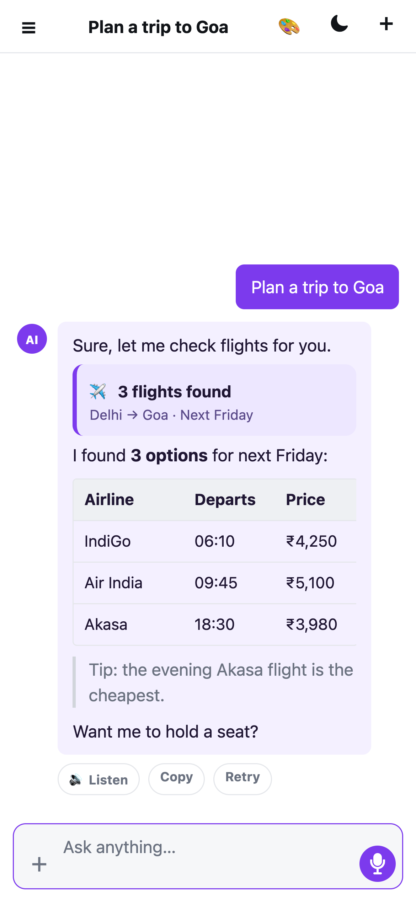

# react-native-ai-chat-kit

[](https://www.npmjs.com/package/react-native-ai-chat-kit)
[](https://github.com/yogesh2902/react-native-ai-chat-kit/actions/workflows/ci.yml)
[](LICENSE)

**Add a ChatGPT-quality AI chat to your React Native or Expo app in minutes.**

Smooth streaming markdown, tool-call cards, chat history, stop/retry, dark mode, and a `useChat()` hook that works with **OpenAI, Anthropic (Claude), Google Gemini, the Vercel AI SDK, or your own backend**.

<table>
  <tr>
    <td align="center" width="25%"><br><sub>Starter suggestions</sub></td>
    <td align="center" width="25%"><br><sub>Code with highlighting</sub></td>
    <td align="center" width="25%"><br><sub>Tool cards and tables</sub></td>
    <td align="center" width="25%"><br><sub>Photo and file sharing</sub></td>
  </tr>
  <tr>
    <td align="center" width="25%"><br><sub>Photos optimized: 1.5 MB to 114 KB</sub></td>
    <td align="center" width="25%"><br><sub>Chat history</sub></td>
    <td align="center" width="25%"><br><sub>Dark mode</sub></td>
    <td align="center" width="25%"><br><sub>Your brand: colors, avatars, cards</sub></td>
  </tr>
</table>

<sub>Real screenshots of the <a href="example">example app</a> (mock mode, no API key). A demo GIF is coming.</sub>

```tsx
import { ChatView, useChat, createStreamTransport } from 'react-native-ai-chat-kit';

const transport = createStreamTransport({ url: 'https://your-api.com/chat' });

export default function Assistant() {
  const chat = useChat({ transport });
  return <ChatView {...chat} />;
}
```

## Why

Building AI chat in React Native means solving the same hard problems every time:

- Text **janks or flickers** while tokens stream in
- **Half-written markdown** (`**bold`, unclosed code fences, tables) renders as garbage
- `fetch` in React Native **doesn't stream** response bodies out of the box
- Keyboard, auto-scroll, stop, retry, tool-call states, dark mode…

This kit solves them once, with **zero native dependencies**: pure TypeScript, works in Expo Go, iOS, Android and web.

## Features

- ⚡ **Streaming markdown built for tokens**: unclosed `**bold**`, `` `code` ``, links and code fences render cleanly mid-stream. Completed blocks are memoized, so only the block receiving tokens re-renders.
- 🧠 **Frame-batched updates**: tokens are coalesced into one render per frame, not one per token.
- 🛠️ **Tool-call cards**: show "Searching flights…" → ✓ Done while your agent works.
- 🔌 **Provider-agnostic**: auto-detects OpenAI (Chat Completions & Responses), Anthropic Messages, Vercel AI SDK UI streams, plain text, or this kit's own format.
- 🧑‍💻 **Code blocks** with syntax highlighting and a Copy button.
- 📊 Tables, lists, task lists, quotes, headings, links.
- ⏹️ **Stop & Retry**, error states, "scroll to latest" button.
- 💬 **Starter suggestions** for empty chats, and **follow-up chips** under replies.
- 👍 **Feedback buttons** with an `onFeedback` callback, and ✎ **edit & resend** for the last message.
- 🌍 **Translatable**: every label and screen-reader text can be overridden.
- 🎨 **Fully customizable**: theme, custom fonts, per-piece styles, avatars, custom tool cards, send/stop buttons and history rows.
- 🌗 **Light/dark themes**, fully overridable.
- ⌨️ Enter-to-send on web/desktop, keyboard-aware on iOS/Android.
- 📎 **Images & documents** with automatic image optimization, plus 🎙 **voice input** and 🔊 **read-aloud**.
- 🔑 **Connect any AI in one line**: OpenAI, Claude or Gemini, plus a ready-made secure server.
- 🗂️ **Chat history**: saved conversations you can reopen and continue, with a ready-made history screen.
- 🧪 **Mock transport** for demos, tests and building UI without an API key.

## Install

```sh
npm install react-native-ai-chat-kit
# or
npx expo install react-native-ai-chat-kit
```

Requires `react >= 18` and `react-native >= 0.74`. No native modules, no linking.

## Quick start (no API key)

```tsx
import { ChatView, useChat, createMockTransport } from 'react-native-ai-chat-kit';

const transport = createMockTransport();

export default function Screen() {
  const chat = useChat({ transport });
  return (
    <ChatView
      {...chat}
      suggestions={['What can you render?', 'Plan a trip to Goa']}
    />
  );
}
```

## Connect a real model

### Option A: just a provider and an API key (prototyping)

```tsx
import { createProviderTransport } from 'react-native-ai-chat-kit';

const transport = createProviderTransport({
  provider: 'anthropic', // 'openai' | 'anthropic' | 'gemini'
  apiKey: process.env.EXPO_PUBLIC_AI_KEY!,
  model: 'claude-sonnet-5-5',
  system: 'You are a friendly travel assistant.',
});
```

With `provider: 'openai'` plus `baseUrl`, it also works with any OpenAI-compatible API: OpenRouter, Groq, Together, Mistral, Ollama, LM Studio and others.

> ⚠️ This bundles your API key into the app, where anyone can extract it. That's fine while prototyping, so it **refuses to run in production builds** unless you pass `dangerouslyAllowApiKeyInApp: true`. Use option B before you ship.

### Option B: the ready-made server (production)

Your key stays on the server. Switching providers is a settings change, not a code change.

**1. Deploy the handler.** It's one file, and it runs on Vercel/Next.js, Cloudflare Workers, Deno, Bun or Node/Express:

```ts
// app/api/chat/route.ts  (Next.js / Vercel)
import { createChatHandlerFromEnv } from 'react-native-ai-chat-kit/server';

const handler = createChatHandlerFromEnv(process.env);
export const POST = handler;
export const OPTIONS = handler;
```

Copy-paste templates for Next.js, Cloudflare and plain Node, plus an `env.example`, are in [`templates/server`](templates/server).

**2. Set environment variables** on the server:

| Variable | Example |
| --- | --- |
| `AI_PROVIDER` | `openai`, `anthropic` or `gemini` |
| `AI_API_KEY` | your provider key (or `OPENAI_API_KEY` / `ANTHROPIC_API_KEY` / `GEMINI_API_KEY`) |
| `AI_MODEL` | e.g. `claude-sonnet-5-5` |
| `AI_SYSTEM_PROMPT` | optional: the assistant's instructions |
| `AI_BASE_URL` | optional: an OpenAI-compatible API |
| `CHAT_ACCESS_TOKEN` | optional: require `Authorization: Bearer <token>` from the app |

**3. Point the app at it:**

```tsx
const transport = createStreamTransport({ url: 'https://your-app.vercel.app/api/chat' });
```

The server converts every provider's stream into one format, handles CORS, drops system messages sent by app users (so they can't override your prompt), and limits message and attachment sizes. For more control, use `createChatHandler({ provider, apiKey, model, authorize, transformMessages, … })`, for example to check your own user sessions or add retrieved documents (RAG).

### Option C: your own backend

`createStreamTransport({ url })` understands OpenAI, Anthropic, Gemini and Vercel AI SDK streams as-is, so an existing backend can just pass the stream through.

## Images, documents and voice

```tsx
import * as ImagePicker from 'expo-image-picker';
import * as DocumentPicker from 'expo-document-picker';
import * as ImageManipulator from 'expo-image-manipulator';
import * as Speech from 'expo-speech';
import { ExpoSpeechRecognitionModule } from 'expo-speech-recognition';
import { createExpoAttachmentPickers, createExpoSpeech, createExpoSpeechRecognizer } from 'react-native-ai-chat-kit';

const attachments = createExpoAttachmentPickers({ ImagePicker, DocumentPicker, ImageManipulator });
const speech = createExpoSpeech(Speech);
const voice = createExpoSpeechRecognizer(ExpoSpeechRecognitionModule, { lang: 'en-US' });

<ChatView {...chat} attachments={attachments} voice={voice} speech={speech} />;
```

- **📎 Photos, camera and files**: a ＋ button opens Photos / Camera / Files, and picked items show as removable previews above the input.
- **Image optimization**: photos are resized to 1568px on the longest side (the size Claude, GPT and Gemini all handle best) and compressed to JPEG before upload. A 4 MB phone photo usually becomes about 200–400 KB. Tune it with `image: { maxDimension, quality }`.
- **Documents**: PDFs are sent to the model as files, and text files (txt, md, csv, json, code) are read and given to the model as text.
- **🎙 Voice input**: the mic shows while the input is empty. Speech becomes text you can review before sending, or set `autoSendVoice` to send it immediately.
- **🔊 Read aloud**: a Listen button on each reply reads it with markdown and code stripped out. Tap again to stop.
- Each piece is optional, and you pass in the modules you installed, so the kit adds no native dependencies. All of these work in Expo Go except `expo-speech-recognition`, which needs a [development build](https://docs.expo.dev/develop/development-builds/introduction/). On web, use `createWebSpeechRecognizer()`.
- Not using Expo modules? Pass your own functions: `attachments={{ pickImages: async () => [...] }}` and `voice={{ start, stop }}`. See `AttachmentPickers`, `SpeechRecognizer` and `TextToSpeech`.

## Expo or React Native CLI?

**Both.** The kit is pure TypeScript with no native code, so it installs the same way in Expo (managed or prebuild) and in React Native CLI apps.

- Chat UI, streaming, markdown, history, customization, server: work everywhere.
- The optional attachment and voice adapters use Expo modules. In a React Native CLI app, either run `npx install-expo-modules` once to use them, or plug in libraries like `react-native-image-picker` or `@react-native-voice/voice` through the same small interfaces.

## Customization

Everything is customizable, from a color tweak to a fully custom UI.

**1. Theme: colors, font, sizes, light/dark**

```tsx
<ChatView
  {...chat}
  colorScheme="auto" // 'light' | 'dark' | 'auto'
  theme={{
    colors: { accent: '#7C3AED', userBubble: '#7C3AED', userText: '#fff', assistantBubble: '#F4F0FF' },
    fontFamily: 'Inter-Regular', // load it first, e.g. with expo-font
    fontFamilyBold: 'Inter-Bold',
    fontSize: 15,
    radius: 8,
  }}
/>
```

**2. Style any piece**

```tsx
<ChatView
  {...chat}
  styles={{
    userBubble: { borderBottomRightRadius: 2 },
    assistantBubble: { borderWidth: 1, borderColor: '#E9E3FF' },
    composerBox: { borderColor: '#7C3AED', borderWidth: 1.5 },
    input: { fontSize: 17 },
    suggestionChip: { backgroundColor: '#F4F0FF' },
  }}
/>
```

Slots: `messageRow`, `userBubble`, `assistantBubble`, `userText`, `avatar`, `listContent`, `composer`, `composerBox`, `input`, `suggestionChip`, `suggestionText`.

**3. Swap in your own components**

```tsx
<ChatView
  {...chat}
  renderAvatar={(m) => (m.role === 'assistant' ? <Image source={botLogo} style={{ width: 28, height: 28 }} /> : null)}
  renderToolCall={(part) =>
    part.name === 'search_flights' && part.state === 'done' ? <FlightResults data={part.result} /> : undefined // undefined = default card
  }
  renderTypingIndicator={() => <LottieView source={thinking} autoPlay loop style={{ height: 24 }} />}
  renderSendButton={({ onPress, disabled }) => <MySendButton onPress={onPress} disabled={disabled} />}
  renderStopButton={({ onPress }) => <MyStopButton onPress={onPress} />}
  composerProps={{ accessoryLeft: <AttachButton />, accessoryRight: <MicButton /> }}
  emptyState={<MyWelcome />}
  header={<MyHeader />}
/>
```

History rows too: `<ChatHistory renderItem={({ session, active, onPress, onDelete }) => <MyRow … />} />`.

**4. Full control**: `renderMessage` replaces a whole message, or build your own screen from `useChat`, `StreamingMarkdown`, `MessageBubble`, `Composer`, `ToolCallCard` and `TypingIndicator`. Use `useChatTheme()` and `fontStyle(theme)` to match the kit's look in your own components.

## Feedback, editing, follow-ups and translations

```tsx
<ChatView
  {...chat}
  onFeedback={(message, rating) => analytics.track('ai_feedback', { id: message.id, rating })}
  labels={{ placeholder: 'कुछ भी पूछें…', emptyTitle: 'मैं कैसे मदद करूँ?', copy: 'कॉपी', retry: 'फिर से' }}
/>
```

- **👍 / 👎 feedback**: pass `onFeedback` and every reply gets thumbs up/down. With `useChat` or `useChatSessions` spread in, the rating is also saved on the message (`message.rating`), so it survives in chat history. Tapping again removes it (`rating: null`).
- **✎ Edit & resend**: the user's latest message gets an Edit action. The text goes back into the input with an "Editing message · Cancel" banner; sending replaces that message and everything after it, then gets a fresh reply (attachments are kept). Use `chat.editMessage(id, text)` directly, or `allowEdit={false}` to hide it.
- **Follow-up chips**: tappable suggestions under the latest reply; tapping one sends it. They come from the reply stream (a `{ "type": "suggestions", "suggestions": [...] }` event from your backend, or `{ suggestions: [...] }` in a mock script), or from the app: `followUps={(message) => ['Tell me more', 'Summarize']}`. `followUps={false}` hides them.
- **Translations**: `labels` overrides any of the ~60 strings (buttons, placeholders, history date groups, month names, screen-reader labels). `<ChatHistory labels={…}>` takes the same object, and `defaultLabels` shows every key.

## Chat history (previous conversations)

Swap `useChat` for `useChatSessions` and every conversation is saved automatically. Users can reopen any past chat and keep talking: new replies get that chat's full history as context.

```tsx
import AsyncStorage from '@react-native-async-storage/async-storage';
import { ChatHistory, ChatView, createKeyValueStore, useChatSessions } from 'react-native-ai-chat-kit';

const store = createKeyValueStore(AsyncStorage); // or MMKV, SQLite, your server…

function Assistant() {
  const chat = useChatSessions({ transport, store, restoreLastSession: true });
  const [showHistory, setShowHistory] = useState(false);

  return showHistory ? (
    <ChatHistory
      sessions={chat.sessions}
      activeSessionId={chat.activeSessionId}
      onSelect={(id) => { chat.openSession(id); setShowHistory(false); }}
      onDelete={chat.deleteSession}
      onNewChat={() => { chat.newSession(); setShowHistory(false); }}
    />
  ) : (
    <ChatView {...chat} header={<Button title="History" onPress={() => setShowHistory(true)} />} />
  );
}
```

- **`useChatSessions`** returns everything `useChat` does, plus `sessions`, `activeSessionId`, `newSession()`, `openSession(id)`, `deleteSession(id)`, `renameSession(id, title)`, `clearSessions()` and `deleteSessionsOlderThan(days)`.
- **Clean up old chats**: delete one by long-pressing it, wipe everything with `clearSessions()` (pass it as `onClearAll` to show a "Clear all chats" button with confirmation), or set `maxAgeDays: 30` to auto-delete stale chats on startup.
- Titles come from the first message, and previews from the last one.
- Saving happens on every reply, and is throttled while tokens stream, so nothing is lost if the app is killed mid-answer.
- Switching chats mid-reply stops the reply and saves what arrived so far.
- **`<ChatHistory />`** groups chats ChatGPT-style (Today, Yesterday, Previous 7 days…), with search and long-press to delete.
- Bring your own storage by implementing `ChatStore` (`list`, `load`, `save`, `remove`), e.g. to sync chats to your backend.

## API

### `useChat(options)`

| Option | Type | |
| --- | --- | --- |
| `transport` | `ChatTransport` | **Required.** Where responses come from. |
| `initialMessages` | `ChatMessage[]` | Restore a saved conversation. |
| `onFinish` | `(message) => void` | Assistant finished (or was stopped). Save history here. |
| `onError` | `(error) => void` | Stream failed. |

Returns `{ messages, status, isStreaming, error, send, stop, retry, clear, setMessages, rateMessage, editMessage }`.

`send(text, { attachments })` also takes attachments from the pickers (see *Images, documents and voice*).

### `<ChatView />`

Spread `useChat()` into it, plus:

| Prop | Description |
| --- | --- |
| `colorScheme` | `'light' \| 'dark' \| 'auto'` (default `auto`) |
| `theme` | Partial overrides, e.g. `{ colors: { accent: '#7C3AED' }, radius: 12 }` |
| `suggestions` | Starter prompts shown when the chat is empty |
| `placeholder`, `header`, `emptyState` | Customize the chrome |
| `onCopyCode`, `onCopyMessage` | Enable Copy buttons, e.g. `Clipboard.setStringAsync` from `expo-clipboard` |
| `onLinkPress` | Defaults to `Linking.openURL` |
| `onFeedback` | Show 👍/👎 under replies and get `(message, rating)` |
| `followUps` | Create follow-up chips in the app, or `false` to hide them |
| `allowEdit` | Show Edit on the latest user message (default `true` when `editMessage` is spread in) |
| `labels` | Translate or reword any UI text |
| `attachments`, `voice`, `speech` | Photos/files, speech-to-text and read-aloud |
| `renderMessage` | Render messages yourself |
| `bottomInset`, `keyboardVerticalOffset` | Safe-area and header offsets |

### Transports

```ts
createStreamTransport({ url, headers?, body?, format?: 'sse' | 'text', parser? })
createMockTransport({ reply?, tokenDelayMs?, initialDelayMs? })
```

A transport is just an async generator, so you can write your own (WebSocket, Firebase, on-device model…):

```ts
const myTransport: ChatTransport = async function* ({ messages, signal }) {
  yield { type: 'tool-call-start', id: '1', name: 'search_docs', label: 'Searching docs…' };
  yield { type: 'tool-call-end', id: '1' };
  yield { type: 'text-delta', text: 'Found it!' };
};
```

### Building blocks

Use the pieces on their own: `StreamingMarkdown`, `MessageBubble`, `Composer`, `ToolCallCard`, `TypingIndicator`, plus `parseBlocks`, `parseInline` and `highlight`.

```tsx
<StreamingMarkdown streaming={isStreaming}>{text}</StreamingMarkdown>
```

## Run the example

```sh
cd example
npm install
npx expo start        # press i / a / w for iOS, Android, web
```

Set `EXPO_PUBLIC_CHAT_URL=https://your-api.com/chat` to use a real backend instead of the mock.

## Development

```sh
npm install
npm test          # unit tests (markdown parser, SSE decoding, provider parsers, transports)
npm run typecheck
npm run build     # emits lib/
```

## License

MIT
